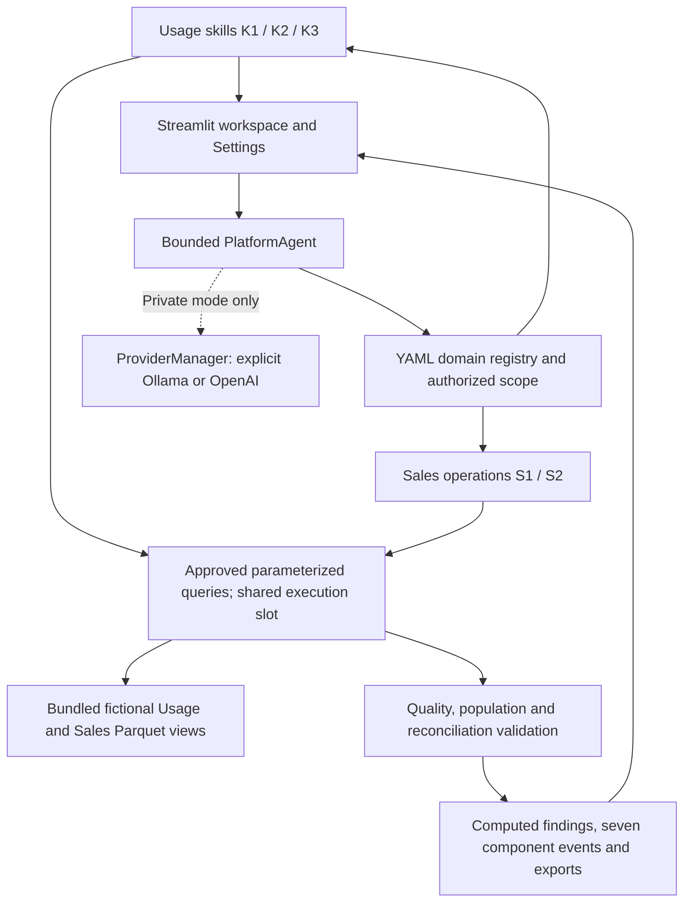

# Architecture

The Streamlit UI is a presentation layer. Agent, provider, semantic, skill and
query contracts are Python modules independent of Streamlit, so a later React
frontend can use the same backend. PlatformAgent routes two registered domains; no LangGraph,
vector database, microservices or multiple agents are introduced.

## Modules and boundaries

| Module | Responsibility |
|---|---|
| `app.py`, `analytics_agent/ui.py` | Chat, charts, settings, explorer and evaluation |
| `config.py` | Server configuration; secrets excluded from repr |
| `models.py` | Frozen Pydantic periods, requests, scopes, values and evidence |
| `metrics.yaml`, `semantics.py` | Versioned business definitions, owners and dimensions |
| `engine.py` | Temporary DuckDB connections, views, approved SQL, permission filters, resource limits and cache |
| `skills.py` | K1 comparison, K2 contribution, K3 cohorts and shared validation |
| `providers.py` | Ollama REST, OpenAI SDK, error classification and one-direction fallback |
| `agent.py` | Typed planning, bounded execution, clarification, context and fact selection |
| `platform.py`, `domains.yaml` | Domain routing, separate authorized contexts, real metadata retrieval and seven component events |
| `sales_models.py`, `sales_parser.py` | Typed sales periods, metric/filter contracts and bounded question interpretation |
| `sales_metrics.yaml`, `sales_engine.py`, `sales_skills.py` | Sales source catalog, integer-cent queries and S1/S2 validation/execution |
| `platform_ui.py`, `exports.py` | Component inputs/outputs, sales charts and in-memory CSV/Excel/PDF/JSON downloads |
| `scripts/` | Reproducible generation, independent validation/oracle, diagnostics, evaluation, demos and startup |
| `tests/fixtures/` | Independent reference answers, never imported by the agent |

## Numerical truth and model behavior

Usage LLM planning returns a validated `plan_investigation` tool call containing only approved
metrics, filters, periods and K1–K3 tasks. Arbitrary SQL and code are absent from
the tool schema. Numerical values come from executed DuckDB functions and
deterministic arithmetic. The optional explanation request can select/order
computed observation IDs; model-authored numerical prose is not shown. This
conservative design prioritizes traceable accuracy over free-form narratives.

Recognized comparison and investigation questions also carry a server-resolved
request and skill contract. It fixes whole-month end-exclusive boundaries and
approved skill selection before execution. The original model plan is still
checked for denied populations and skills; correction cannot hide an authorization
failure. Applied semantic corrections appear in the public execution trace.
Repeated tasks with identical effective arguments are coalesced, while different
dimensions or cohorts remain distinct. Every result chart/table has a unique
Streamlit key so repeated result content cannot crash the UI.

Sales private-provider planning uses the typed `plan_sales` contract after actual
metadata retrieval. SQL comes from server-owned templates with separate bound
parameters. Model-authored numbers and arbitrary SQL are never executed or shown.
Sales live model inference remains unverified; mock provider contracts are tested.

The deterministic mode uses a bounded parser for documented questions, not a
general natural-language substitute. Local/private mode requires explicit selection;
the owner-approved public demo always uses deterministic execution. Unsupported
data and ambiguous questions return refusal or clarification without analytics.
Context stores the last authorized request and rechecks its scope on follow-up.

## Data and metric semantics

There are 100,000 fictional accounts, five markets, three fictional services and
four fictional models. Events span July–September 2026; user registration can
precede July. Timestamp values are stored as UTC-naive instants and interpreted
exclusively as UTC. Periods are half-open. Device and membership joins validate
effective dates. Duplicate event IDs are reduced before counting users.

MAU unions users across selected services. DAU is a calendar-day mean including
zero-activity days. New users are eligible registrations in the period; existing
active users registered before its start. Activation is same-period activation
among new registrations. Adoption is period activity among eligible users.
User-based metric device filters use the device valid at the period end;
activity metric filters use the event-time device. Adoption v1.1 includes device
and membership associations that actually overlap each other within the selected
period in both populations; this prevents a device switch from removing the
denominator while retaining an active numerator. This distinction is explicit
and is tested against the independent pandas implementation.

K2 reconciles only additive metrics with exclusive populations in both periods.
Service distinct counts and device histories can overlap; ratios are not added.
New/existing cohorts are period-relative, not a fixed retention cohort. Registration
cohorts are YYYY-MM; membership cohorts are Standard/Premium and may overlap
when multiple services are selected.

Primary August/September data are complete. A separate `incomplete/` activity
partition is missing September 24–30. Historical freshness is assessed against
the declared October 5 synthetic snapshot, not presented as live freshness.

The second warehouse contains 25,000 fictional orders and 50,000 canonical sales
lines, plus 500 physical retransmissions, over April-September 2026. Four products,
five markets and three channels are fictional. Primary Q2/Q3 coverage is complete;
a separate incomplete partition omits September 24-30. Net sales use integer USD
cents: gross minus discounts and returns plus signed adjustments. Units are gross
invoiced units; orders are distinct and overlap across product groups. S1 compares
totals/monthly trends; S2 reconciles only additive, exclusive groups. The sales
catalog contains logical source mappings, actual view schemas, PK/FK relationships,
business meanings and approved policies. Independent pandas oracles are never
imported by either runtime domain. See PIPELINE_COMPONENT_TRACE.md for each stage.

## Execution, caching and security

Every skill checks its allowlist and scope. SQL filters also constrain unfiltered
requests to authorized markets/services. Data Explorer requires full demo scope.
Production mode adds Streamlit OIDC and a server-owned issuer+subject scope map.
Missing/expired claims, unapproved identities and incomplete grants fail closed;
Render forces production mode. Local mode uses the fictional demonstration scope.
Actual identity-provider login is unverified. Scope changes discard retained
results/conversation; raw OIDC secrets never enter application session state.
Existing private grants default to usage only; sales requires an explicit domain
grant. Public mode permits only the two fixed bundled synthetic paths/manifests
and blocks provider initialization and all non-demo calls. Enterprise databases,
Teams/Slack/email and cross-domain joins are unconnected or unsupported.

DuckDB connections are created and closed within each operation, never shared
between Streamlit threads. The database is in memory, with read-only Parquet
views and a read-only application API. Trusted internal DDL creates views;
untrusted callers cannot supply SQL. External access is restricted to exact
bundled files; extensions are disabled and configuration is locked. Default query
timeout is 15 seconds, result limit 500 rows, one thread, and 512 MB tracked
DuckDB memory. Disk spill is disabled; Streamlit/Python memory is additional.

Immutable approved results are cached in 32 entries. Keys include scope,
request, period, source size/mtime and resource limits. Permission checks still
run on hits; copies prevent cross-request mutation. Evidence labels cache hits.
No LLM object, key, token or raw model response is cached.
One reentrant warehouse lock bounds shared-engine sessions and coalesces concurrent
cache misses. Queue waits respect query/investigation deadlines. Quality and DAU
trends are reused across metric requests with current request-correct evidence.
Four simultaneous investigations are included in the local benchmark; this is
not proof of production-scale traffic capacity.

Trend calendars include every reporting date, with zero only for covered days and
null gaps for missing/partial days. Provisional coverage appears above the KPI cards
and in the chat answer. Ratio changes use percentage points and relative percentage
change separately. Conflicting duplicate payloads, invalid joins, orphan references
and impossible ingestion timestamps withhold findings.

Provider errors are classified and redacted. Only explicit OpenAI selection can
call cloud inference. Missing key, timeout, connectivity and temporary service
failures may fall back to reachable Ollama with the configured model. Authentication,
invalid requests and invalid model output never trigger fallback. Once fallback
occurs, the rest of that answer stays local. Remote Ollama requires HTTPS and a
server token for a protected proxy. The application cannot verify proxy policy;
the deployment owner must enforce it. Network limits use native connect/read
timeouts; host DNS/network scheduling can affect exact elapsed time.

## Validation and remaining limits

The test suite includes 30 independent pandas comparisons, a hand-calculated
small warehouse, routing/context tests, provider mocks, UI AppTest and five
real deterministic demo workflows. Evaluation dashboards read aggregate actual
JUnit results, not expected answers. See `FINAL_VALIDATION_REPORT.md` for measured
results, startup, latency, memory, browser evidence and external blockers.

OpenAI inference and the August/September K1 browser workflow are verified locally.
Linux/Render hosting, Ollama inference and broader live model behavior still require
separate verification. See reports/openai_live_validation.json.
Before enterprise use validate real identity integration and principal revocation,
real lineage/completeness contracts, live provider routing, broader language
evaluations and expected-load behavior in the hosted environment.
